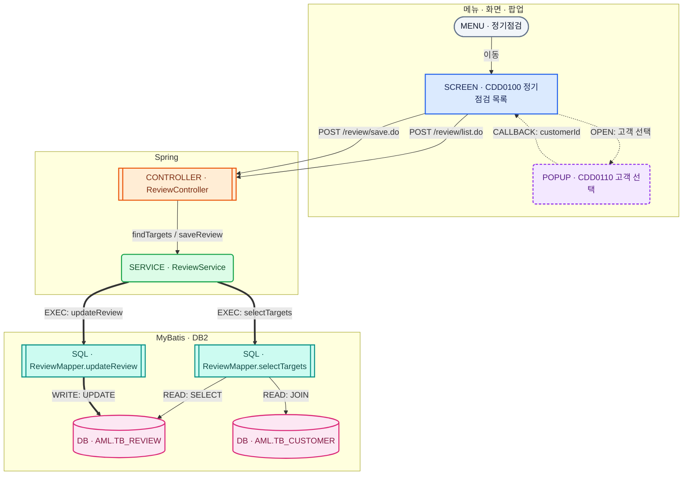
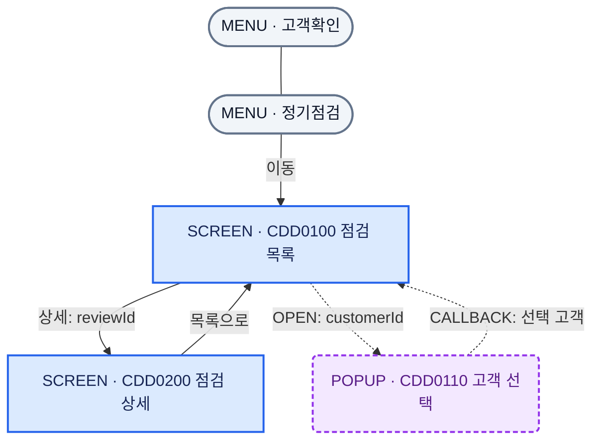
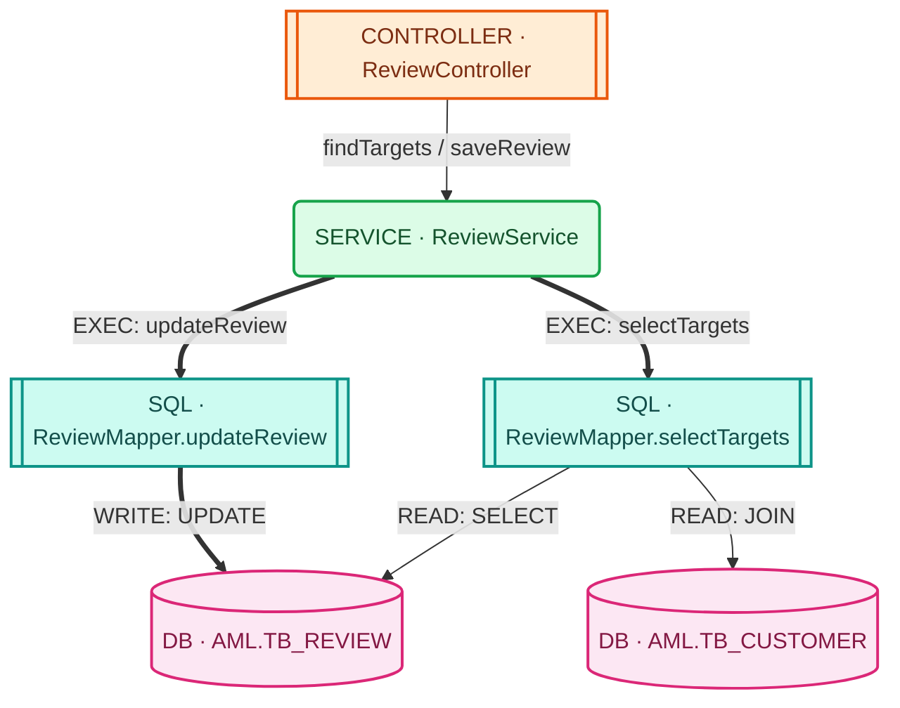
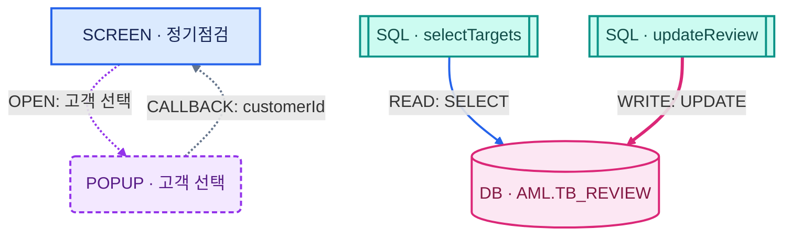

# Mermaid 업무·소스 연결도 패턴

화면, 메뉴, 팝업, Controller, Service, SQL, DB를 하나의 규칙으로 표현하는 복사용 템플릿이다.
Spring + MyBatis + Nexacro 화면을 예로 들었으며, 이름·URL·테이블명은 모두 설명용 가상 값이다.

여기서 **클래스**는 Java 클래스가 아니라 Mermaid flowchart의 스타일 클래스(`classDef`)를 뜻한다.
구성요소 관계를 보여주는 문서이므로 `classDiagram` 대신 `flowchart`를 사용한다.

## 1. 노드 종류와 이름 규칙

색상 + 도형 + 종류 접두어를 함께 사용한다. 색상을 구분하기 어려워도 종류를 읽을 수 있다.

| 종류 | 스타일 클래스 | ID 접두어 | 도형 | 라벨 예시 | 색상 |
|---|---|---|---|---|---|
| 메뉴 | menu | MENU_ | 캡슐 | MENU · 정기점검 | 회색 |
| 화면 | screen | SCR_ | 사각형 | SCREEN · CDD0100 정기점검 목록 | 파랑 |
| 팝업 | popup | POP_ | 둥근 사각형 | POPUP · CDD0110 고객 선택 | 보라 |
| Controller | controller | CTL_ | 이중 사각형 | CONTROLLER · ReviewController | 주황 |
| Service | service | SVC_ | 둥근 사각형 | SERVICE · ReviewService | 초록 |
| SQL | sql | SQL_ | 이중 사각형 | SQL · ReviewMapper.selectTargets | 청록 |
| DB / 테이블 | db | DB_ | 원통 | DB · AML.TB_REVIEW | 분홍 |

- ID는 영문·숫자·밑줄로 만들고 같은 다이어그램 안에서 유일하게 지정한다.
- 라벨에는 업무명 또는 소스 식별자를 넣는다. 파일 경로나 메서드 전체 목록은 아래 표로 분리한다.
- SQL ID에는 MyBatis의 `namespace.statementId`를 표시한다.
- DB 노드는 기본적으로 `스키마.테이블명` 단위다. DB 인스턴스를 표현할 때는 `DB · DB2 AML`처럼 명시한다.
- 큰 지도는 구성요소 단위, 상세 지도는 메서드·SQL 단위로 나눈다.

## 2. 공통 스타일 정의

아래 정의를 **각 Mermaid 블록 내부**의 마지막에 붙인다. 한 블록의 classDef는 다른 블록으로 공유되지 않는다.
Mermaid 스타일은 대상 종류를 자동 판별하지 않으므로 `:::screen` 또는 `class SCR_LIST screen;`으로 직접 지정한다.

```text
classDef default fill:#F8FAFC,stroke:#64748B,color:#0F172A,stroke-width:1.5px;
classDef menu fill:#F1F5F9,stroke:#64748B,color:#0F172A,stroke-width:2px;
classDef screen fill:#DBEAFE,stroke:#2563EB,color:#172554,stroke-width:2px;
classDef popup fill:#F3E8FF,stroke:#9333EA,color:#581C87,stroke-width:2px,stroke-dasharray:5 3;
classDef controller fill:#FFEDD5,stroke:#EA580C,color:#7C2D12,stroke-width:2px;
classDef service fill:#DCFCE7,stroke:#16A34A,color:#14532D,stroke-width:2px;
classDef sql fill:#CCFBF1,stroke:#0D9488,color:#134E4A,stroke-width:2px;
classDef db fill:#FCE7F3,stroke:#DB2777,color:#831843,stroke-width:2px;
```

각 노드의 배경색과 글자색을 함께 지정한 고정 팔레트다. 주변 페이지가 어두운 테마여도 노드 내부는 밝게 표시된다.

## 3. 종류별 연결선 정의

아래 의미는 **이 문서에서 정한 프로젝트 규칙**이다. Mermaid가 API·콜백·DB 쓰기를 자동 인식하지 않는다.
선 모양만으로 구분하기 어려운 관계는 반드시 라벨을 같이 쓴다.

| 관계 | 방향 | 복사할 문법 | 규칙 |
|---|---|---|---|
| 하위 메뉴 포함 | 상위 메뉴 → 하위 메뉴 | `MENU_ROOT --- MENU_CHILD` | 화살표 없는 실선: 정적 계층 |
| 화면 열기 / 이동 | 메뉴 또는 화면 → 화면 | `MENU_A -->\|이동\| SCR_A` | 실선 화살표 |
| 팝업 열기 | 화면 → 팝업 | `SCR_A -. OPEN: 고객 선택 .-> POP_A` | 점선 + OPEN |
| 팝업 결과 콜백 | 팝업 → 호출 화면 | `POP_A -. CALLBACK: customerId .-> SCR_A` | 점선 + CALLBACK |
| HTTP / Nexacro transaction 요청 | 화면 또는 팝업 → Controller | `SCR_A -->\|POST /review/list.do\| CTL_A` | 실선 + 실제 URL |
| Java 메서드 호출 | Controller → Service 또는 Service → Service | `CTL_A -->\|findTargets()\| SVC_A` | 실선 + 메서드명 |
| Mapper statement 실행 | Service → SQL | `SVC_A ==>\|EXEC: selectTargets\| SQL_A` | 굵은 화살표 + EXEC |
| DB 읽기 | SQL → DB | `SQL_A -->\|READ: SELECT\| DB_A` | 실선 + READ |
| DB 쓰기 | SQL → DB | `SQL_B ==>\|WRITE: UPDATE\| DB_A` | 굵은 화살표 + WRITE |
| 응답 / 반환 | 호출 대상 → 호출자 | `CTL_A -. RETURN: dsResult .-> SCR_A` | 점선 + RETURN |

아래 코드를 그대로 복사해 연결선을 선언한다.

```text
MENU_ROOT --- MENU_CHILD
MENU_A -->|이동| SCR_A
SCR_A -. OPEN: 고객 선택 .-> POP_A
POP_A -. CALLBACK: customerId .-> SCR_A
SCR_A -->|POST /review/list.do| CTL_A
CTL_A -->|findTargets()| SVC_A
SVC_A ==>|EXEC: selectTargets| SQL_A
SQL_A -->|READ: SELECT| DB_A
SQL_B ==>|WRITE: UPDATE| DB_A
CTL_A -. RETURN: dsResult .-> SCR_A
```

DB 읽기/쓰기의 화살표는 **SQL이 어느 테이블에 접근하는지**를 뜻한다. SELECT 결과의 물리적인 데이터 흐름은 아니다.
UPDATE, INSERT, DELETE, MERGE는 WRITE로 표시한다. JOIN은 SQL에서 관련 테이블 각각으로 READ 선을 연결한다.
양방향 화살표로 요청과 응답을 합치지 않고, 반환을 강조할 때만 RETURN 선을 별도로 그린다.

## 4. 바로 복사하는 전체 템플릿

노드명과 연결선 라벨만 바꿔 사용할 수 있다. 조회와 저장이 서로 다른 SQL을 실행하는 관계까지 포함한다.



## 5. 메뉴·화면·팝업만 자세히 보기

메뉴 계층은 무방향 실선, 화면 이동은 실선 화살표, 팝업과 콜백은 점선으로 구분한다.



## 6. 소스·SQL·테이블 영향도 보기

하나의 Service에서 조회·저장 SQL이 분기되는 형태다. Mapper 인터페이스 또는 DAO를 별도 분석하려면 Service와 SQL 사이에 추가하고, SQL 노드는 statement 단위를 유지한다.



## 7. 연결선 색상까지 지정하는 선택 패턴

기본 템플릿은 모양과 라벨로 의미를 전달한다. 읽기·쓰기·콜백을 더 강조할 때만 linkStyle을 추가한다.
아래 인덱스는 **연결선 선언 순서 기준, 0부터 시작**한다. 노드나 classDef의 줄 번호가 아니다.
선을 추가하거나 순서를 바꾸면 linkStyle 인덱스도 함께 수정한다.



## 8. 다이어그램과 함께 관리할 소스 매핑 표

아래 표는 위 예시의 소스 위치를 문서로 관리하는 형식이다. 실제 프로젝트 값으로 바꾼다.

| 노드 ID | 종류 | 소스 / 식별자 | 주요 동작 |
|---|---|---|---|
| MENU_REVIEW | 메뉴 | MENU_CDD_REVIEW | CDD0100 열기 |
| SCR_REVIEW | 화면 | cdd/CDD0100.xfdl | 조회·저장 transaction |
| POP_CUSTOMER | 팝업 | cdd/CDD0110.xfdl | 고객 선택 결과 콜백 |
| CTL_REVIEW | Controller | ReviewController.java | /review/list.do, /review/save.do |
| SVC_REVIEW | Service | ReviewService.java | findTargets, saveReview |
| SQL_LIST | SQL | ReviewMapper.xml / ReviewMapper.selectTargets | 대상 목록 조회 |
| SQL_SAVE | SQL | ReviewMapper.xml / ReviewMapper.updateReview | 점검 결과 수정 |
| DB_REVIEW | DB | AML.TB_REVIEW | 조회·수정 대상 |
| DB_CUSTOMER | DB | AML.TB_CUSTOMER | JOIN 조회 대상 |

## 9. 작성·유지 규칙

1. 처음에는 4장의 전체 템플릿을 복사한 뒤 노드·라벨을 수정한다.
2. 도형은 노드 선언에서, 색상은 classDef에서 지정한다. 클래스 지정만으로 도형은 바뀌지 않는다.
3. 관계가 많은 지도는 TB 방향으로 두고 메뉴·화면, 서버, 데이터 영역으로 묶는다.
4. 노드 하나에 긴 경로·전체 SQL·전체 메서드를 넣지 않는다. 소스 매핑 표로 보완한다.
5. 요청과 반환을 모두 표시하면 선이 늘어나므로 반환은 팝업 콜백이나 핵심 응답에 한정한다.
6. 실제 연결이 확인된 항목만 그린다. 예상 관계는 라벨에 “추정”을 명시한다.
7. DB 간 JOIN 관계는 SQL 노드에서 각 테이블로 연결한다. 테이블끼리의 FK 관계는 별도 ER 다이어그램으로 관리한다.
8. Mermaid 블록마다 필요한 classDef를 포함한다. 외부 CSS나 CDN은 이 문서에 필요하지 않으며 렌더링 환경에는 Mermaid 엔진이 있어야 한다.
9. 한글 라벨은 큰따옴표로 감싸고, 노드 ID에 소문자 `end`를 사용하지 않는다.
10. 로컬 Markdown 뷰어에서는 Mermaid 렌더링을 켠다. 로컬 번들 환경도 같은 Mermaid 소스를 사용할 수 있다.

기본 도형, classDef, 실선·점선·굵은 화살표, linkStyle 문법을 사용한다. 최신 전용 도형·아이콘·외부 스타일 의존성은 없다.
렌더러의 버전·폰트·레이아웃 설정에 따라 노드 크기와 배치는 달라질 수 있다.

참고: [Mermaid 공식 flowchart 문법](https://mermaid.js.org/syntax/flowchart.html)
